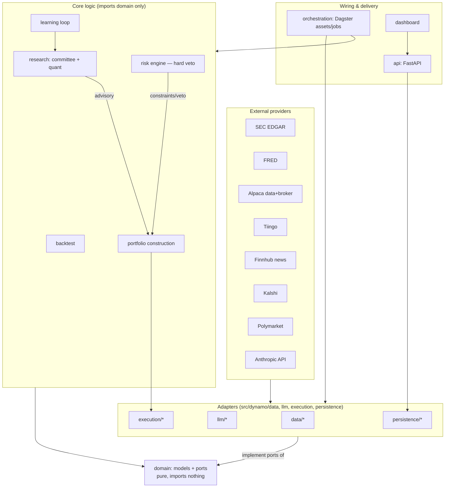

# 01 — System Architecture

## 1. Shape of the system

A modular monolith in one repo, deployed as a small set of containers on one host. Clean
Architecture applied *lite*: a pure domain core, ports (Python `Protocol`s), adapters, and **one
enforced dependency rule** — no ceremony beyond that (ADR-0006).



## 2. Module map and the dependency rule

| Package | Role | May import |
|---|---|---|
| `dynamo.domain` | Typed entities (pydantic) + ports (`Protocol`) | stdlib, pydantic only |
| `dynamo.risk`, `dynamo.portfolio`, `dynamo.research`, `dynamo.backtest`, `dynamo.learning` | Core logic, pure where possible | `dynamo.domain` |
| `dynamo.data`, `dynamo.llm`, `dynamo.persistence`, `dynamo.execution` | Adapters implementing ports | `dynamo.domain`, provider SDKs |
| `dynamo.config` | pydantic-settings, env enum | stdlib, pydantic |
| `dynamo.api`, `orchestration/` | Delivery + wiring (composition root) | everything |
| `dynamo.observability` | structlog config, Prometheus metrics | stdlib deps |

Enforced by **import-linter** in CI (contracts already in `pyproject.toml`):
1. `domain` imports nothing from dynamo.
2. Core logic never imports adapters — it receives port implementations via constructor injection.

**Dependency injection** is a hand-rolled composition root (`api/wiring.py` +
`orchestration/wiring.py`): typed factory functions building the object graph from config. No DI
framework (ADR-0006).

### Key domain entities

`Instrument`, `Bar`, `Filing`, `NewsItem`, `InsiderTx`, `UniverseMembership(tier, as_of)`,
`Dossier`, `AgentOpinion`, `CommitteeVerdict`, `QuantScore`, `Signal`, `QualityScore`,
`PredictionMarketView`, `RegimeState`, `RiskLimits`, `RiskVerdict`, `TargetPortfolio`,
`Position`, `Order`, `Trade`, `DecisionContext`, `JournalEntry`, `ModelVersion`,
`PromotionRecord`. Schemas: `02` (data), `03` (research), `06` (risk), `09` (execution),
`10` (learning).

### Key ports

```python
class MarketDataProvider(Protocol): ...   # bars, quotes, corporate actions
class FilingsProvider(Protocol): ...      # EDGAR filings + XBRL facts
class MacroProvider(Protocol): ...        # FRED series
class NewsProvider(Protocol): ...
class PredictionMarketProvider(Protocol): ...
class Broker(Protocol): ...               # submit/cancel/positions/account
class ResearchModel(Protocol): ...        # Claude calls (messages + batches) behind one interface
class ForecastModel(Protocol): ...        # quant models — modular so DL can slot in later (ADR-0003)
class EmbeddingModel(Protocol): ...       # local sentence-transformers
# Repositories: one per aggregate *cluster*, not per entity (ReportRepository,
# MarketDataRepository, PortfolioRepository, JournalRepository, ModelRegistry)
```

## 3. Runtime topology (Docker Compose, one host)

| Container | Purpose | Notes |
|---|---|---|
| `postgres` | TimescaleDB + pgvector, system of record | Separate databases per env (§5) |
| `dagster-webserver`, `dagster-daemon` | Orchestration: assets, schedules, sensors, backfills | Storage in the same Postgres |
| `api` | FastAPI: reports, portfolio, risk, journal, admin actions | Uvicorn, stateless |
| `dashboard` | Streamlit (M1–M5) → React+nginx (M6) | Talks only to `api` |
| `prometheus`, `grafana` | Metrics + ops dashboards + alert rules | Healthchecks.io ping for dead-man switch |

All images are 12-factor (config via env, stateless, health endpoints) — K8s-compatible by
construction, no manifests maintained (ADR non-goal).

Sizing: fits a 4 vCPU / 8 GB host. If RAM proves tight, Dagster → Prefect is the designated
fallback (ADR-0002); nothing else changes because orchestration code is a thin layer over core
functions.

## 4. Primary data/control flow (the nightly research loop)

```mermaid
sequenceDiagram
    participant D as Dagster (schedule)
    participant DATA as data adapters
    participant Q as research.quant
    participant T2 as Tier-2 detectors
    participant LLM as llm.batch_runner
    participant C as research.committee
    participant R as risk engine
    participant DB as persistence

    D->>DATA: ingest bars/filings/news/macro/insider/pred-markets
    DATA->>DB: upsert + provenance + quality checks
    D->>T2: scan broad market (code-only anomaly detectors)
    T2->>DB: flags → Haiku triage batch → promotions (Tier 3)
    D->>Q: features → quant scores (Tier 1 + promoted)
    D->>C: select deep-dive set (events, staleness, rank moves; hard cap)
    C->>LLM: batch: dossier analyst → bull & bear → arbiter (Message Batches)
    LLM-->>C: structured JSON (validated, retried once, else quarantined)
    C->>DB: AgentOpinions + CommitteeVerdicts + reports + ranked watchlist
    D->>R: risk snapshot (exposures, VaR, regime) — independent of committee
    R->>DB: RiskVerdicts + alerts
```

Portfolio construction and execution (M4/M5) consume `CommitteeVerdict` + `QuantScore` +
`RiskVerdict`; the risk engine's output is a **constraint set**, not an opinion (`06`).

## 5. Environment separation

Four environments, one enum, no code branches on env except the execution gate:

| Env | Database | Broker | Claude | Purpose |
|---|---|---|---|---|
| `DEV` | `dynamo_dev` | none/mock | real (small caps) | Development |
| `TEST` | `dynamo_test` | mock | recorded/mocked | CI, integration tests |
| `PAPER` | `dynamo_paper` | Alpaca paper | real | The operating system of record until live |
| `LIVE` | `dynamo_live` | Alpaca live | real | Only after §5 gate in `00` |

Rules:
- Config loads from `.env.<env>`; `DYNAMO_ENV` selects. Secrets never in code or logs
  (structlog processors redact known keys).
- The live gate (`execution/gate.py`): live orders require `DYNAMO_ENV=LIVE` **and** a valid
  signed human-approval artifact (`approvals/live-<date>.yaml`, checked into git) **and** the
  kill-switch file absent. Any failure → orders refused, alert raised. Paper and live differ
  *only* in adapter credentials/base-URL — same code path.
- Promotion of models/strategies between envs goes through the model registry
  (`08-backtesting-and-validation.md`); production configs can only reference registry entries
  written by the promotion tool.

## 6. Cross-cutting concerns

- **Logging:** structlog JSON to stdout; every log line carries `run_id`, `env`, `module`;
  Dagster run IDs join pipeline logs to asset materializations.
- **Metrics:** Prometheus — pipeline durations, provider error/rate-limit counters, Claude
  tokens/$ (cost meter), schema-validation failures, risk-limit utilization, abstention rate.
- **Alerting:** Grafana alert rules → Telegram; Healthchecks.io dead-man ping from the nightly
  job (silence = alert). Alert catalog in `12-operations.md`.
- **Errors:** provider adapters normalize errors into typed exceptions
  (`RateLimited`, `ProviderDown`, `DataGap`); pipelines degrade per-asset, never all-or-nothing;
  quarantine tables hold invalid records for inspection.
- **Idempotency:** all ingestion upserts are natural-key idempotent; batch submissions carry
  deterministic `custom_id`s so retries never duplicate; orders use client-order-ids (`09`).
- **Time:** everything stored UTC; market-calendar logic (`exchange_calendars`) centralized in
  one module; **as-of discipline**: every derived table records the data-cutoff timestamp it saw.
- **Testing strategy:** detailed in each module doc; summary — unit (pure logic, hypothesis
  property tests for risk math), integration (dockerized Postgres + vcrpy cassettes), golden
  (frozen agent outputs for schema regression), end-to-end nightly dry-run in CI weekly.

## 7. Security

- Single-user; dashboard/API bound to localhost + tailscale/VPN or basic auth — no public surface.
- Secrets: `.env` files on host, encrypted at rest in repo via sops/age for backup parity
  (`12-operations.md`); GitHub Actions secrets for CI. No Vault (overkill, ADR-0008).
- Principle of least privilege: Alpaca keys are paper-scoped until the live gate; Anthropic key
  budget-capped by the cost meter; DB users per service with minimal grants.
- Supply chain: uv lockfile, dependabot, `pip-audit` in CI.
