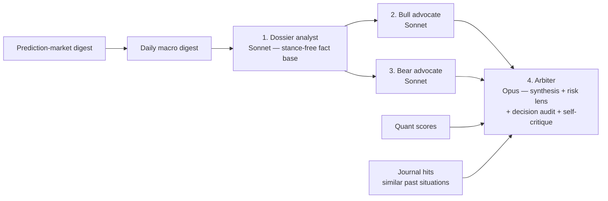

# 03 — Claude Research Committee (v2)

Claude is the platform's research team — and only that. It proposes and explains; the risk
engine and human own decisions. Anthropic is the sole hosted LLM provider (user requirement);
every Claude interaction goes through the `ResearchModel` port in `llm/`.

## 1. Design principle: independence where it pays

Independent viewpoints add value at the **judgment** level (bull vs bear), not the
**extraction** level (reading filings). Parallel copies of extraction duplicate cost without
adding information. Hence the 4-call adversarial structure per deep-dive:



Bull and bear receive the same dossier, opposing mandates, and **cannot see each other's
output** — genuine adversarial independence. The arbiter must explicitly rebut the bear's
kill-cases (with evidence references) before it may emit `buy`; abstention is rewarded in the
prompt and never penalized in evaluation.

### Call roster

| Call | Model | Cadence | Purpose |
|---|---|---|---|
| Tier-1 screen / Tier-2 triage | Haiku 4.5 | Nightly batch | Cheap materiality classification of flags & news |
| Macro digest | Sonnet | **Once daily, whole market** | Rates/inflation/regime narrative + prediction-market implied probabilities, injected everywhere |
| Prediction-market analysis | Sonnet | Daily (within macro digest job) | Estimated vs implied probability per tracked market (§6) |
| Dossier analyst | Sonnet | Per deep-dive | Integrated fundamental+filing+technical+news fact base |
| Event specialists: earnings-call reader, new-filing deep-read | Sonnet | Event-fired only | Write into the persistent dossier store |
| Bull advocate / Bear advocate | Sonnet ×2 | Per deep-dive | Strongest honest case each way |
| Arbiter | Opus | Per deep-dive | Verdict + folded-in decision audit & self-critique |
| Refresh short-path | Sonnet + Opus | Unchanged names | Dossier-delta + arbiter only (2 calls) |
| Post-trade review | Opus | Per closed trade + weekly portfolio review | `10-learning-loop.md` |

Deep-dive selection nightly: new promotions + event-triggered (earnings, filings, >2σ moves,
quant-rank jumps) + staleness rotation (verdict older than 14d) — **hard cap enforced in code**
(default 8/night).

## 2. Structured output schemas

All calls return JSON validated against pydantic models (structured-output enforced via the
API's JSON-schema output mode; one retry on validation failure, then quarantine + alert).
Prompts are versioned files (`research/agents/prompts/*.md`, semver in frontmatter); every
stored output records `prompt_version` and `model_id`.

```python
class Evidence(BaseModel):
    claim: str
    source_type: Literal["filing","news","fundamental","price","macro","prediction_market","journal"]
    source_ref: str          # accession no. / news id / metric key / series id — resolvable
    as_of: date

class DossierAnalysis(BaseModel):        # call 1 — stance-free
    symbol: str; as_of: date; prompt_version: str
    business_summary: str
    fundamentals: FundamentalsRead       # growth, margins, FCF, balance-sheet reads w/ Evidence
    filing_deltas: list[Evidence]        # what changed since last read
    technical_state: TechnicalRead       # trend, RS, vol state, key levels
    news_catalysts: list[Evidence]
    data_gaps: list[str]                 # feeds the data roadmap

class AdvocateBrief(BaseModel):          # calls 2 & 3
    symbol: str; side: Literal["bull","bear"]
    thesis: str                          # ≤ 200 words
    key_points: list[Evidence]           # every point referenced
    kill_cases: list[KillCase]           # bear: what breaks the stock; bull: what breaks the bear
    expected_move_pct: float; horizon_days: int
    conviction: float                    # 0–1, P(this side's thesis materially correct)

class CommitteeVerdict(BaseModel):       # call 4 (arbiter)
    symbol: str; as_of: date
    action: Literal["buy","add","hold","trim","sell","avoid","no_action"]
    conviction: float
    thesis: str; bull_case: str; bear_case: str
    bear_rebuttals: list[Rebuttal]       # REQUIRED non-empty for buy/add, each with Evidence
    risks: list[str]
    exit_conditions: list[ExitCondition] # checkable predicates where possible
    expected_upside_pct: float; expected_downside_pct: float
    horizon_days: int
    position_size_hint_pct: float        # advisory only — risk engine decides (doc 06)
    disagreement_score: float            # §4
    dissents: list[Dissent]              # never deleted, always rendered
    self_critique: str                   # what would change my mind / weakest link
    quant_alignment: Literal["agree","neutral","conflict"]
    journal_context_used: list[str]      # journal entry ids consulted
```

## 3. Prompt & caching architecture

Context assembled strictly **stable → volatile** for prompt-cache efficiency:

1. **System prompt** per role — versioned file, zero interpolation (no dates/ids) →
   `cache_control` breakpoint.
2. **Ticker dossier context** — deterministic serialization (sorted keys, fixed number
   formats): instrument profile, quant scores, price/vol stats, filing excerpts (selected
   sections, not whole filings), news digest, macro digest, journal hits. ~8–15k tokens →
   second breakpoint. Shared verbatim by calls 1–4 for that ticker.
3. **Role-specific instruction + question** — small, after the last breakpoint.

Batches process concurrently, so cache hits are best-effort: submit stage-by-stage (dossier
batch → advocates batch → arbiter batch) to maximize prefix reuse, but the budget model
(§7) assumes **zero** cache savings; observed savings (tracked via
`usage.cache_read_input_tokens`) are upside.

Refusal/failure handling: refusal or off-schema twice → quarantined with the raw response
stored; the night's report renders whatever succeeded and lists gaps explicitly. A batch
expiring (>24h) → resubmit failures only via deterministic `custom_id`s.

## 4. Disagreement measurement

- Stances mapped to a score: bull conviction `+c_bull`, bear `−c_bear`, arbiter action mapped
  to [−2,+2]. `disagreement_score` = normalized conviction-weighted dispersion ∈ [0,1].
- Categorical checks, each surfaced on the report: (a) bull-vs-bear expected-value gap;
  (b) `quant_alignment` conflict (LLM stance vs quant score direction); (c) committee-implied
  probability vs prediction-market implied probability where a mapped market exists.
- **Guardrails in code, not prompts:** `action ∈ {buy, add}` is rejected by the committee
  assembler if `disagreement_score > 0.6` or any bear `KillCase(severity="high")` lacks a
  matching `Rebuttal` — the verdict downgrades to `hold`/`no_action` with reason logged.

## 5. Cost model & kill-switch

Standard API prices halved by Message Batches. Assumptions: zero cache savings, 8 deep dives
+ 2 refreshes/night, 40 Tier-2 triage calls, one macro digest.

| Component (nightly) | In / out tokens | ~Cost |
|---|---|---|
| Haiku triage 40 × (3k/0.3k) | 120k / 12k | $0.09 |
| Macro digest (Sonnet, 1 × 12k/3k) | 12k / 3k | $0.04 |
| Dossier 8 × (14k/3k) | 112k / 24k | $0.35 |
| Advocates 16 × (16k/2.5k) | 256k / 40k | $0.68 |
| Arbiter (Opus) 8 × (22k/3k) | 176k / 24k | $0.74 |
| Refresh 2 × (8k/1k + 18k/2.5k Opus) | — | $0.14 |
| **Nightly total** | | **~$2.05** |

× 22 trading days ≈ **$45/mo**, + weekly Opus portfolio review + post-trade reviews + interactive
dashboard Q&A ≈ **$55–75/mo steady state** — inside the $40–90 envelope with real headroom.
Scaling knobs in order: deep-dives/night ↑ → dossier size → refresh cadence.

`llm/cost_meter.py`: records tokens & dollars per call/run/month (Prometheus gauge);
**refuses new batch submissions once the monthly cap (`CLAUDE_MONTHLY_BUDGET_USD`) is hit**;
alert at 70%. The meter is written first in M1 — no Claude call ships before it.

## 6. Prediction-market analysis (research-only)

Daily job over tracked markets passing the thin-market filter (doc 02 §7):

```python
class PredictionMarketView(BaseModel):
    venue: str; market_id: str; question: str
    market_implied_prob: float
    estimated_prob: float                # committee estimate
    edge: float                          # estimated − implied
    confidence: float                    # in the ESTIMATE, distinct from edge
    uncertainties: list[str]             # REQUIRED non-empty
    evidence: list[Evidence]
    historical_comparisons: list[str]
    why_wrong: list[str]                 # REQUIRED: reasons the estimate could be wrong
```

Consumed as: (a) macro-digest inputs (Fed/CPI/recession odds), (b) calibration checks for the
macro agent (implied vs estimated tracked over resolutions), (c) single-name event context
(M&A/FDA odds in dossiers). **No execution hooks exist**; `edge` is a research artifact and the
UI copy says so.

## 7. Evaluation & versioning

- Golden tests: frozen dossier inputs → schema-valid outputs asserted in CI (structure, not
  content).
- Prompt changes are PRs: side-by-side old/new outputs on a fixed 10-ticker evaluation set,
  human-reviewed; prompt version bumps recorded in every stored output.
- Per-agent Brier scores and reliability curves from M7 close the loop (`10-learning-loop.md`);
  a persistently miscalibrated role triggers prompt revision, never silent reweighting.
