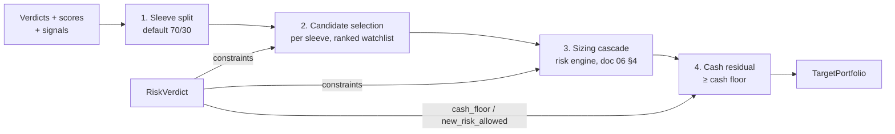

# 07 — Portfolio Construction

Portfolio construction turns advisory research into a single **portfolio-level** decision. It
never reasons about one position in isolation: the unit of output is a `TargetPortfolio`
(weights summing to 1 with cash), produced by deterministic rules under the risk engine's
constraint set. The optimizer proposes; `RiskVerdict` disposes (`06-risk-engine.md` §1).

## 1. Position in the system

```
TargetPortfolio = construct(advisory_inputs) subject to RiskVerdict.constraints
```

| Input | Source | Role |
|---|---|---|
| `CommitteeVerdict` per symbol | `03-claude-committee.md` | Action + conviction + exit conditions — advisory |
| `QuantScore` per symbol | `04-quant-models.md` | Expected return / downside / vol estimates, rank — advisory |
| Quality scores | `04-quant-models.md` | Long-term sleeve eligibility filter — advisory |
| Strategy signals | `05-strategies-and-scoring.md` | Tactical sleeve entries/exits, sleeve split config — advisory |
| `RiskVerdict` | `06-risk-engine.md` | **Hard constraints.** Caps, cash floor, `new_risk_allowed`, vetoes — non-negotiable |
| Current `Position`s + cash | `09-execution.md` reconciliation | Diff base |

Two properties are structural, not aspirational:

1. **Hard constraints are not inputs to a trade-off.** The constructor treats every field of
   `RiskVerdict` as an inviolable bound. There is no code path in which an attractive
   opportunity relaxes a cap; conflicts resolve to the constraint (guiding principle 1,
   `00-goals-and-non-goals.md` §8). If constraints make a desired portfolio infeasible, the
   feasible portfolio (usually: fewer names, more cash) ships, and the clamps are logged.
2. **Same code path everywhere.** `portfolio/` is pure (state in, `TargetPortfolio` out, no
   I/O or clock reads) and is imported unchanged by the event-driven backtest validator
   (`08-backtesting-and-validation.md` §1), paper, and live.

## 2. Phase 1: deterministic rule-based construction

Phase 1 is a transparent rule pipeline, not a numerical optimizer. Every step is a pure
function with loggable intermediate output, so any weight in the final portfolio can be
explained as "step N did X because Y."



### Step 1 — Sleeve split

Investable equity (1 − cash floor, further reduced by vol-targeting and regime effects, §4)
splits between the long-term quality sleeve and the tactical sleeve. Default 70/30 per
`05-strategies-and-scoring.md`; bounds per risk bucket (§5). `RegimeState` and the drawdown ladder can
shrink the tactical sleeve (doc 06 §3, §8) — the split honors whichever is tighter.

### Step 2 — Within-sleeve candidate selection

From the ranked watchlist (nightly committee output, doc 03):

- **Long-term sleeve:** symbols with `CommitteeVerdict.action ∈ {buy, add, hold}` AND quality
  score above the sleeve floor AND quant rank in the top configured fraction. Existing holdings
  with `hold` are retained; `trim`/`sell` verdicts generate reductions/exits regardless of rank.
- **Tactical sleeve:** active strategy signals (doc 05) filtered by regime eligibility and, when
  a committee verdict exists for the name, vetoed by `avoid`/`sell`. Tier-3 promoted names are
  tactical-only unless graduated to core (doc 02 §2).
- Selection is capped at the bucket's max position count (§3), filled in rank order. A symbol
  may hold positions in **both sleeves simultaneously, as separate lots with per-sleeve exits**
  (doc 05 §5 owns this rule); per-position, sector, and cluster caps apply to the **combined**
  exposure (doc 06 §7), and the two lots count as two positions against the bucket's count caps.
- Any symbol carrying a `RiskVerdict.vetoes` entry, a data-quality quarantine (doc 02 §6), or a
  liquidity fail (doc 06 §10) is excluded before ranking — exclusions are logged with reasons.

### Step 3 — Sizing (delegated, not duplicated)

Position sizing is **entirely owned by the risk engine's sizing cascade** —
volatility-normalized base, bounded conviction tilt, fractional-Kelly ceiling, clamp cascade,
0.5% floor (`06-risk-engine.md` §4). Portfolio construction passes the candidate set per sleeve
and receives clamped weights back. This doc deliberately specifies no sizing math: one
implementation, one property-test suite, one place to audit.

### Step 4 — Cash as residual, with a floor

`cash = 1 − Σ weights`, and the constructor guarantees `cash ≥ RiskVerdict.cash_floor`. If the
sized candidate set would breach the floor, lowest-ranked positions are dropped (never
proportionally shaved below the 0.5% floor) until it holds.

### Why rule-based first

With ~10–30 positions and expected-return estimates that are mostly noise, classical
mean-variance optimization is an **error-maximization machine**: it loads up on whatever the
estimation error flatters, and tiny input changes produce large allocation swings. A rule
pipeline is transparent (every weight has a narrative), testable (each step is a pure function
with golden cases), and stable (rank-based selection is robust to small score perturbations).
The volatility-normalized sizing in doc 06 §4 already captures most of the diversification
benefit an optimizer would deliver at this position count.

### Designed-in upgrade path

The constructor sits behind a port so a convex optimizer can slot in without touching callers:

```python
class PortfolioOptimizer(Protocol):
    def construct(
        self, candidates: SleeveCandidates, verdict: RiskVerdict,
        current: Portfolio, config: ConstructionConfig,
    ) -> TargetPortfolio: ...

# Phase 1: RuleBasedConstructor. Phase 2 (criteria below): CvxpyOptimizer —
# maximize risk-adjusted score s.t. the same RiskVerdict constraint set,
# expressed as cvxpy constraints; turnover penalty in the objective.
```

Entry criteria for the cvxpy implementation (all logged as an ADR when triggered):
position count sustained > 25, **or** multiple constraints binding simultaneously such that
greedy rank-order filling demonstrably leaves feasible risk budget unused, **or** a
multi-objective need (e.g., factor-neutrality) that rules cannot express cleanly. Both
implementations must pass the identical property-test suite (§9) before the swap.

## 3. Risk buckets as construction presets

Low / Medium / High are parameter presets over one code path (doc 06 §2). Beyond the risk
limits owned by doc 06, portfolio construction adds these bucket parameters:

| Parameter | Low | Medium (default) | High |
|---|---|---|---|
| Sleeve split (long-term / tactical) | 85/15 | 70/30 | 60/40 |
| Sleeve split bounds (tactical max) | 20% | 35% | 50% |
| Max position count (total) | 15 | 25 | 30 |
| Max tactical positions | 4 | 8 | 12 |
| Monthly one-way turnover budget | 8% | 15% | 25% |
| Min trade size (weight change) | 0.25% | 0.25% | 0.25% |

Bucket selection is owner config (`ConstructionConfig`), changed only via the same promotion
discipline as risk parameters (doc 06 §11).

## 4. Cash policy: not investing is a first-class outcome

Cash is never "what's left over by accident" — it is the explicit output of four mechanisms:

| Mechanism | Behavior |
|---|---|
| Cash floor | Per-bucket floor from `RiskVerdict.cash_floor` (doc 06 §2); constructor guarantees it |
| Vol-targeting overflow | When realized portfolio vol exceeds the bucket target band, exposure scales down (doc 06 §9); the freed weight **goes to cash**, not redistribution |
| Regime response | `risk_off` → gross cap 80% (doc 06 §8), mechanically raising cash; `crisis` → `new_risk_allowed = false`, so exits accumulate as cash |
| Candidate scarcity | If ranked candidates above quality/conviction floors run out, remaining budget stays in cash — the constructor never reaches down the list to "get invested" |

The dashboard renders cash level with its attribution (floor / vol / regime / scarcity) so a
40%-cash portfolio reads as a decision with reasons, not a bug. Per doc 00, "do nothing" is a
celebrated output; high cash is its portfolio-level expression.

## 5. Rebalancing

### Triggers (evaluated nightly after the research loop; any one suffices)

| Trigger | Default threshold |
|---|---|
| Drift | Position weight deviates > 25% **relative** from target (e.g., 8% target drifts past 10% or below 6%) |
| Verdict change | New `CommitteeVerdict` changes action for a held name (e.g., hold → trim/sell) or a new buy enters the selectable set |
| Risk-limit breach | Any `RiskVerdict` constraint violated by current holdings (clamp to compliance is mandatory, exempt from turnover budget) |
| Regime change | `RegimeState` transition (with doc 06 §8 hysteresis already applied) |
| Scheduled review | Monthly full reconstruction on the first trading day |

### Turnover budget and noise suppression

- Monthly one-way turnover ≤ bucket budget (Medium 15%, §3), tracked cumulatively; when
  exhausted, only mandatory trades execute (risk breaches, stops, explicit `sell` verdicts).
  Discretionary improvements queue for the next cycle.
- Trades below **0.25% weight change are skipped** — rebalancing noise costs spread and
  attention and buys nothing. Skipped diffs are logged and roll into the next trigger.
- Vol-targeting adjustments respect the turnover budget except when the drawdown ladder or
  `crisis` regime mandates de-risking — capital preservation outranks turnover discipline.

### Tax awareness

Paper phase: **none** — Alpaca paper has no tax reality, and premature tax logic is untestable
complexity. For live: LT/ST holding-period awareness (defer sales within 30 days of long-term
treatment when the verdict is not `sell`) is **flagged as future work, not built now**; the
`TargetPortfolio` diff already carries per-lot data so it can be added without schema change.

## 6. Output: TargetPortfolio and the rebalance proposal

```python
class TargetWeight(BaseModel):
    symbol: str
    weight: float
    sleeve: Literal["long_term", "tactical"]
    strategy_id: str | None          # tactical sleeve: which doc-05 strategy
    verdict_id: str | None           # CommitteeVerdict that admitted/retained it
    rationale: str                   # one sentence, rendered on dashboard

class ProposedChange(BaseModel):
    symbol: str
    current_weight: float
    target_weight: float
    source: str                      # sleeve/strategy/verdict that drove the change
    trigger: Literal["drift","verdict_change","risk_breach","regime_change","scheduled","vol_target"]
    rationale: str
    constraints_applied: list[str]   # every clamp/cap that touched this weight, from RiskVerdict

class TargetPortfolio(BaseModel):
    as_of: datetime
    risk_verdict_ref: str            # the RiskVerdict this was constructed under
    weights: list[TargetWeight]
    cash: float
    cash_attribution: dict[str, float]   # floor / vol_target / regime / scarcity
    changes: list[ProposedChange]        # diff vs current portfolio
    turnover_used_mtd: float
```

Flow: `TargetPortfolio` → diff vs reconciled current positions → proposed order list →
execution (`09-execution.md`). Every proposed change carries its **source, rationale, and the
constraint set applied** — the traceability contract (doc 00 §4) extends from research claims
through to orders.

**Human visibility before orders, even in paper:** the rebalance proposal renders on the
dashboard (per-change rationale, constraint annotations, turnover impact) before order
submission. Paper mode defaults to `auto_approve: true` after a configurable review window
(default 30 min); live mode requires explicit approval per doc 01 §5 — but the proposal
artifact and its rendering are identical in both, so the approval habit is built during paper.

## 7. Attribution design

Every position is **tagged at entry** with `(sleeve, strategy_id, verdict_id)` and the tags are
immutable for the life of the lot (stored on the `Position`/`Trade` records, doc 09). Adds to
an existing position record their own tags per lot. This enables downstream decomposition
without reconstruction guesswork:

- **By sleeve:** long-term vs tactical P&L, the primary allocation-policy feedback.
- **By strategy:** each doc-05 strategy's realized contribution vs its backtest expectation
  (`10-learning-loop.md` monitors this gap for strategy decay).
- **By decision:** P&L per `CommitteeVerdict`, feeding committee calibration (Brier scores,
  doc 03 §7) and per-agent evaluation (`11-dashboard-and-api.md` renders the decomposition).

Weight changes from purely mechanical actions (vol targeting, drift rebalance, ladder
de-risking) are tagged `mechanical:<trigger>` so research attribution is never polluted by
risk-management noise.

## 8. Implementation notes

- `portfolio/` imports `dynamo.domain` only (import-linter contract, doc 01 §2); construction
  is deterministic — no randomness, no wall-clock, all inputs explicit.
- Deterministic iteration order everywhere (sorted symbols, stable sort on ranks with symbol
  tiebreak) so identical inputs produce byte-identical `TargetPortfolio` JSON — this is what
  makes the golden tests and backtest/paper parity meaningful.
- Config in `ConstructionConfig` (pydantic), versioned; changes follow the promotion pipeline
  (`08-backtesting-and-validation.md`) — sleeve splits and turnover budgets are production
  logic, same as risk parameters.

## 9. Testing

| Suite | Contract |
|---|---|
| **Property tests (hypothesis, 10k randomized scenarios)** | Random verdicts/scores/positions/`RiskVerdict`s → constructed portfolio **never violates any `RiskVerdict` constraint** (per-position, sector, cluster, gross, cash floor, `new_risk_allowed`, vetoes); weights + cash = 1; turnover budget respected; no weight below floor |
| Determinism | Same inputs (including shuffled input ordering) → byte-identical `TargetPortfolio` |
| Golden scenarios | Frozen input fixtures (normal night, risk_off regime, ladder at −8%, candidate scarcity, turnover exhaustion, infeasible-set fallback) → asserted full outputs, reviewed on any diff |
| Degradation | Missing quant scores / stale verdicts / empty candidate list → valid high-cash portfolio, never an exception |
| Optimizer parity (Phase 2 gate) | `CvxpyOptimizer` must pass the identical property suite before it may replace `RuleBasedConstructor` |

## 10. Open questions (carried to 14-design-review)

1. Should drift rebalancing use per-sleeve bands (tactical tighter than long-term) rather than
   one relative band? → decide with paper turnover data in M5.
2. Does the both-sleeves symbol rule (attribute to long-term) understate tactical strategy
   performance? → check attribution reports in M7.
