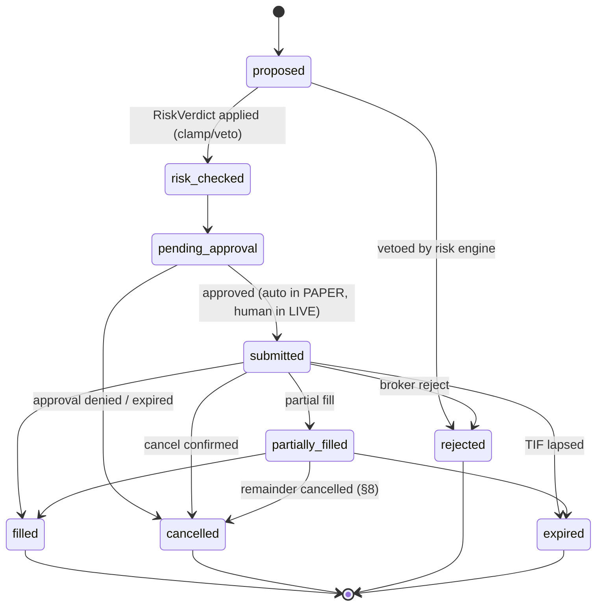

# 09 — Execution & Order Management

Execution is the only place Dynamo touches the outside world with money-shaped consequences,
so it is built like the risk engine: boring, deterministic, reconciled, and fail-closed. The
same code path serves paper and live (doc 00 §8 principle 3); the *only* differences are
adapter credentials/base-URL and the live gate (§7).

## 1. Scope and broker adapter

- **Broker:** Alpaca, **paper first**. Live trading is a future decision gated by doc 00 §5 —
  the code path is identical and exercised daily in paper so that going live changes nothing
  except the gate's answer.
- **SDK:** `alpaca-py`, wrapped entirely behind the `Broker` port (doc 01 §2). Core logic
  (`dynamo.portfolio`, order manager) never imports the SDK; `dynamo.execution.alpaca` is the
  sole adapter. A `MockBroker` implements the same port for `TEST` and backtest-final-validation.
- **Instruments:** US equities + ETFs only (doc 00 §3). No options/futures/crypto endpoints are
  wired; the adapter rejects any non-equity asset class at the port boundary.
- **Cadence:** orders originate from the nightly portfolio-construction job (doc 07) and from
  the 15-minute intraday risk check (stop maintenance, doc 06 §5). No other component may
  submit orders.

```python
class Broker(Protocol):                       # doc 01 — restated with full surface
    def submit(self, order: Order) -> BrokerOrderAck: ...
    def cancel(self, client_order_id: str) -> None: ...
    def replace(self, client_order_id: str, new: OrderAmendment) -> BrokerOrderAck: ...
    def get_order(self, client_order_id: str) -> BrokerOrderState: ...
    def open_orders(self) -> list[BrokerOrderState]: ...
    def positions(self) -> list[BrokerPosition]: ...
    def account(self) -> BrokerAccount: ...   # cash, equity, buying power
```

## 2. Order lifecycle state machine

Every order is a row in `orders` with an explicit state; every transition is timestamped,
written to `order_events` (append-only), and logged with `run_id`. There are no implicit
states — an order the code cannot classify is an incident, not a guess.



| State | Meaning | Set by |
|---|---|---|
| `proposed` | Emitted by portfolio construction from `TargetPortfolio` diff | portfolio module |
| `risk_checked` | Passed the risk engine's final pre-trade check (fresh `RiskVerdict`, not the nightly one) | risk engine |
| `pending_approval` | Awaiting approval. Config `execution.auto_approve` — **true in PAPER** (default), always false in LIVE | order manager |
| `submitted` | Acknowledged by broker; `broker_order_id` recorded | Alpaca adapter |
| `partially_filled` / `filled` | Fill events recorded with price, qty, timestamp | fill stream / poller |
| `cancelled` / `rejected` / `expired` | Terminal; reason string always populated | adapter / order manager |

Transition rules enforced in code (illegal transition raises, never coerces):
- Only `proposed → risk_checked → pending_approval → submitted` reaches the broker. There is
  no shortcut path, including for stop-order maintenance.
- A terminal state is final; corrections happen via new orders, never by mutating history.
- `pending_approval` orders expire after `execution.approval_ttl` (default 30 min in LIVE;
  irrelevant in PAPER where auto-approve is immediate) → `cancelled` with reason
  `approval_expired`.

## 3. Order types policy

Defaults chosen for EOD-cadence strategies on liquid names; all thresholds in
`ExecutionConfig` (pydantic, versioned like `RiskConfig`).

| Situation | Order type | Parameters (defaults) |
|---|---|---|
| Small rebalance in liquid Tier-1 name (order ≤ 1% of 20d median dollar volume **and** spread ≤ 10 bps) | Market-on-open | DAY, opening auction |
| Everything else (default) | **Marketable limit** | Limit = last quote ± offset; offset = max(2 bps, 0.25 × current spread), buys above ask, sells below bid; TIF = DAY |
| Protective stops (doc 06 §5) | Stop (broker-held) | Stop price from risk engine (`RiskVerdict.stop_updates`); GTC, refreshed on recompute |
| Stops where broker-held unsupported (e.g., held-position edge cases, synthetic thesis stops) | **Synthetic stop** | Evaluated on the 15-min intraday check (doc 06 §11); breach → marketable-limit exit order through the full state machine |

Rules:
- Never a naked market order outside the opening auction — a marketable limit caps slippage at
  a known bound; an unfilled limit is a logged outcome, not an emergency.
- Stop-order updates (trailing ratchets) use `replace`, carrying the same `client_order_id`
  lineage; a failed replace → cancel + resubmit, never two live stops for one position.
- Synthetic stops are second-class by design: the dashboard shows which stops are broker-held
  vs synthetic, and the 15-minute check window is an accepted, documented gap risk.

## 4. Idempotency

- **Deterministic client order id:**
  `client_order_id = sha256(target_portfolio_id, symbol, side, ts_bucket)[:24]` where
  `ts_bucket` is the scheduling slot (nightly run date, or 15-min intraday slot for stop
  maintenance). The same intent always hashes to the same id.
- Resubmission after a crash/retry therefore **cannot duplicate**: Alpaca rejects duplicate
  client order ids, and the order manager treats "duplicate id" as "already submitted — go
  fetch its state", not as an error.
- **Startup reconciliation before anything else:** on process start, the order manager pulls
  `open_orders()` + recent order history from Alpaca, matches by `client_order_id`, and
  repairs local state (e.g., an order stuck in `submitted` locally that filled during
  downtime). **No new submissions are accepted until startup reconciliation completes.**
- Mirrors the platform-wide idempotency rule (doc 01 §6): retries never duplicate, at any
  layer.

## 5. Reconciliation

Runs every 15 minutes during market hours (piggybacking the intraday risk check), once after
the close, and on-demand from the dashboard.

1. Fetch Alpaca truth: positions, cash, equity, open orders.
2. Compare against internal `positions` / `orders` / cash ledger.
3. **Any divergence → trading halts.** Position/order mismatch on a symbol → that symbol is
   halted (no new orders, existing stops left in place). Cash or equity mismatch beyond
   `reconciliation.cash_tolerance` (default $1.00, covering fee rounding) → **global halt**.
4. Alert fires (Telegram, doc 01 §6); the halt is **sticky** — it clears only on explicit
   human acknowledgment via the dashboard (`reconciliation_acks` table records who/when/why).
   The system never "re-checks and quietly resumes."

Fills are recorded in `trades` with the decision price (price snapshot in the
`DecisionContext`, §6) alongside the fill price:

```
slippage_bps = side_sign × (fill_price − decision_price) / decision_price × 10⁴
```

Realized slippage feeds two consumers: the transaction-cost model calibration in the backtest
suite (doc 08 — assumed costs must track reality) and post-trade reviews (doc 10 — timing
quality). Realized-vs-model slippage is a first-class metric on the ops dashboard (doc 00 §4
outcome metrics).

## 6. DecisionContext capture (bridge to doc 10)

**No order without a snapshot — enforced in code, not convention.** Before any order leaves
the order manager, an immutable `DecisionContext` row is written capturing everything the
decision saw:

| Field group | Contents |
|---|---|
| Research | `CommitteeVerdict` id (incl. `exit_conditions`, `dissents`, `self_critique`, `journal_context_used`), `QuantScore`s, macro digest ref |
| Risk | `RiskVerdict` (constraints, regime, ladder state), risk config version |
| Portfolio | Full pre-trade portfolio state, `TargetPortfolio` id, sleeve |
| Market | Prices/quotes seen at decision time (the decision price of §5), spread, volume stats |
| Provenance | Config version, prompt versions, `model_id`s, code git SHA, `DYNAMO_ENV`, data-cutoff timestamp (as-of discipline, doc 01 §6) |
| Expectation | Expected upside/downside/horizon from the verdict — what success was supposed to look like |

The order manager's `submit()` signature **requires** a `decision_context_id`; a null or
dangling reference raises before the broker adapter is ever called. The table is append-only
and hash-chained (spec in doc 10 §2 — doc 10 owns the schema; doc 09 owns the guarantee that
every order references a row). This is the "decision-context completeness = 100%" success
metric of doc 00 §4.

## 7. The live gate (`execution/gate.py`)

Expands doc 01 §5. One function, pure, unit-tested, consulted on **every** submission — not
cached, not at startup only:

```python
def live_orders_permitted(env: DynamoEnv, approval: ApprovalArtifact | None,
                          kill_switch_present: bool, readiness: ReadinessReport) -> GateResult:
    ...
```

Live submission requires **all** of:

1. `DYNAMO_ENV == LIVE`.
2. A valid **signed human-approval artifact**: `approvals/live-<date>.yaml`, checked into git,
   containing scope (symbols/sleeves or `all`), expiry date, and a signature over the file
   body (age/minisign key held only by the owner). Expired, out-of-scope, or
   signature-invalid → refused.
3. **Kill-switch file absent** (§8).
4. **Live-readiness criteria of doc 00 §5 satisfied**, evaluated from stored metrics (clean
   paper months, calibration, risk suite green, backup drill) and recorded in the
   `ReadinessReport`; any criterion unmet → refused.

Any refusal returns a typed reason, logs it, and raises an alert — the gate never fails
silently, and the refusal itself is an auditable event. In `PAPER`, the gate short-circuits to
"paper permitted" (conditions 2–4 don't apply), but the *same function* runs, so the code
path stays identical.

### Global kill-switch

- **Trigger:** `touch $DYNAMO_HOME/KILL_SWITCH` on the host, **or** the dashboard's kill
  button (which writes the same file via the API). File-based so it works when the API is the
  thing that's broken.
- **Effect, in order:** (1) all open orders cancelled via `Broker.cancel`; (2) all new
  submissions refused (gate condition 3, checked per-submission); (3) alert fired with the
  file's mtime and creator. Positions are *not* auto-liquidated — that is a human decision.
- **Reset:** delete the file **and** acknowledge on the dashboard; both are logged.
- The drawdown-ladder full stop (doc 06 §3, −20%) engages the same mechanism: the risk engine
  writes the kill-switch file, so there is exactly one halt pathway to test.

### Gate test requirement

An integration test (`tests/integration/test_gate_matrix.py`) enumerates the full truth table
of (env, approval validity, kill-switch, readiness) and **proves live submission is refused in
every non-satisfied combination** — 1 permitted row, all others refused with the correct typed
reason. This test is a release blocker; the gate cannot be modified without updating the
matrix.

## 8. Failure handling

| Failure | Response |
|---|---|
| Alpaca API outage / persistent 5xx | **Halt submissions + alert.** No blind retries: retry once with jitter for transient errors, then halt. Synthetic stop evaluation continues against last good quotes and queues exits for when connectivity returns; the queue is surfaced, not silent |
| Partial fill at day end | **Cancel the remainder, log it.** The unfilled portion re-enters the next nightly `TargetPortfolio` diff naturally; no after-hours chasing |
| Broker reject | Terminal `rejected` with the broker reason stored. **Never auto-retried with looser parameters** — a reject means our model of the market or account is wrong, so it is surfaced on the dashboard and in the nightly report for a human to understand |
| Connection lost mid-order | State is ambiguous → treated as `submitted` until reconciliation (§5) resolves it from Alpaca truth; no resubmission until then (§4 makes accidental resubmission harmless anyway) |
| Order stuck `pending_approval` past TTL | Auto-cancelled, reason `approval_expired`, listed in the nightly report |
| Rate-limited by Alpaca | Token-bucket client-side (doc 02 §1 pattern); hitting 429 is a logged incident and the batch of orders spreads out, never a retry storm |

Fail-closed everywhere: when in doubt, the system holds current positions and stops
initiating. Missing a rebalance by a day is a non-event for EOD strategies; a duplicate or
unaccounted order is an incident.

## 9. Persistence

- `orders(client_order_id PK, broker_order_id, decision_context_id NOT NULL, symbol, side,
  qty, order_type, limit_price, stop_price, tif, state, sleeve, created_at, updated_at)`
- `order_events(id, client_order_id, from_state, to_state, reason, payload jsonb, ts)` —
  append-only transition log (§2)
- `trades(id, client_order_id, symbol, side, qty, fill_price, decision_price, slippage_bps,
  fees, filled_at)`
- `reconciliation_runs(id, ts, scope, result, divergences jsonb)` +
  `reconciliation_acks(run_id, acked_by, acked_at, note)`
- All timestamps UTC (doc 01 §6); `PortfolioRepository` (doc 01 §2) owns this cluster.

## 10. Testing

| Test class | What it proves |
|---|---|
| State-machine property tests (hypothesis) | No sequence of events reaches an illegal transition; terminal states are absorbing; every transition writes exactly one `order_events` row |
| vcrpy cassettes (Alpaca paper) | Adapter correctness against recorded real responses: submit/cancel/replace/fills/rejects, incl. error bodies. Cassettes refreshed quarterly against the paper API |
| Idempotency test | Same intent submitted twice (crash-restart simulation) yields exactly one broker order; duplicate-id response handled as state fetch |
| **Chaos test** | Kill the broker connection mid-order (cassette truncation / fault-injecting mock); assert the order manager halts, startup reconciliation then converges local state to broker truth with zero duplicates |
| Gate refusal matrix (§7) | Every non-satisfied gate combination refuses live submission with the correct typed reason |
| Reconciliation divergence test | Injected position/cash mismatches → correct halt scope (symbol vs global), sticky until ack |
| Synthetic stop test | Simulated 15-min quote breach → exit order created through the full state machine |

`MockBroker` supports scripted fault injection (rejects, partials, latency, disconnects) so
every failure row in §8 has a corresponding test.

## 11. Open questions (carried to 14-design-review)

1. Should marketable-limit offsets adapt to realized fill rates per liquidity bucket (learned
   from §5 slippage data) rather than a fixed spread multiple? → revisit in M6 with data.
2. Opening-auction MOO vs first-30-min limit for the small-rebalance case — measure in paper.
