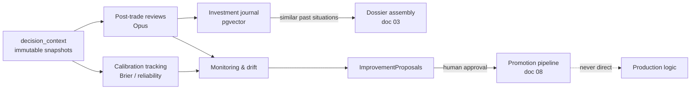

# 10 — Learning Loop

## 1. Purpose and the cardinal rule

The learning loop exists to improve **decision quality** over time: better calibration, better
sizing, earlier detection of decaying edges, institutional memory that survives context
windows. It is explicitly *not* an online-learning system.

**Cardinal rule (doc 00 §7): the learning loop never modifies production logic.** It observes,
measures, reviews, and *proposes*. Every improvement it generates — a retrain, a threshold
change, a prompt revision, a strategy retirement — flows into the promotion pipeline of
`08-backtesting-and-validation.md` and ends at human approval. There is no code path from a
learning-loop output to a production config.



## 2. `decision_context` table (immutable, append-only)

The substrate for everything else. Written by the order manager **before** submission
(doc 09 §6 — no order without a snapshot); rows are never updated or deleted.

```sql
CREATE TABLE decision_context (
    id              uuid PRIMARY KEY,
    created_at      timestamptz NOT NULL,
    env             text NOT NULL,               -- DYNAMO_ENV at decision time
    symbol          text NOT NULL,
    sleeve          text NOT NULL,               -- long_term | tactical
    verdict_id      uuid NOT NULL,               -- CommitteeVerdict
    target_portfolio_id uuid NOT NULL,
    payload         jsonb NOT NULL,              -- full snapshot, schema below
    expected_upside_pct   double precision NOT NULL,
    expected_downside_pct double precision NOT NULL,
    horizon_days    integer NOT NULL,
    prev_hash       bytea NOT NULL,              -- hash chain (below)
    row_hash        bytea NOT NULL
);
```

`payload` (pydantic `DecisionContext`, doc 01 §2) contains the full doc 09 §6 capture: quant
scores, `RiskVerdict` + ladder/regime state, pre-trade portfolio state, prices/quotes seen,
config/prompt/model versions, code git SHA, macro digest ref, data-cutoff timestamp. The
expectation columns are denormalized from the verdict so calibration queries (§5) never need
to parse JSONB.

**Hash-chained integrity:** `row_hash = sha256(prev_hash ‖ canonical_json(row))`, with
`prev_hash` pointing at the previous row's `row_hash` (genesis row uses a fixed constant).
Tampering with or deleting any historical row breaks every subsequent hash — evident, not
preventable, which is the right property for a single-user system auditing itself. The chain
is verified nightly (§9) and before any quarterly calibration report. Database role for the
writer has INSERT only — no UPDATE/DELETE grants (doc 01 §7 least privilege).

## 3. Post-trade review (Opus)

| Trigger | Cadence | Output |
|---|---|---|
| Trade closed (position fully exited) | Within 24h of close | One `PostTradeReview` per closed trade |
| Weekly portfolio review | Sunday, before the new week | Portfolio-level review: allocation, themes, aggregate calibration, "what is the portfolio's weakest assumption" |

**No hindsight leakage:** the review prompt receives the **frozen `DecisionContext`** — the
review sees exactly what the decision saw, plus the outcome. "What was knowable" is judged
strictly against the snapshot; anything learned after the decision timestamp belongs in
`missed_information` only if it was *available* before it (e.g., in a filing already
ingested), which the review must demonstrate with an `Evidence` reference (doc 03 §2), not
assert.

```python
class PostTradeReview(BaseModel):
    trade_id: str; decision_context_id: str; symbol: str
    as_of: date; prompt_version: str; model_id: str
    outcome_pnl_pct: float; holding_days: int
    what_worked: list[str]
    what_failed: list[str]
    confidence_calibration: CalibrationCheck   # was conviction justified by the evidence then held?
    sizing_quality: Assessment                 # too big / right / too small, vs risk-engine base
    timing_quality: Assessment                 # entry & exit vs available signals, slippage (doc 09 §5)
    missed_information: list[Evidence]         # knowable-then only, evidence-referenced
    thesis_remained_valid: bool                # did the thesis break, or just the price?
    exit_honored_exit_conditions: bool         # audited against CommitteeVerdict.exit_conditions
    should_have_exited: Literal["earlier","as_done","later"]
    failure_classification: FailureClassification | None   # §4, required iff pnl < 0
    lessons: list[str]                         # journaled (§6)
```

Reviews are structured output like every committee call (doc 03 §2): JSON-schema validated,
one retry, quarantine + alert on repeated failure. `dissents` in the original verdict are
surfaced in the review prompt — a dissent that predicted the outcome is a calibration signal
for that dissenting stance.

## 4. Failure taxonomy

Every losing closed trade gets **one primary** classification and optionally one secondary:

| Class | Meaning |
|---|---|
| `data_quality` | Decision fed by bad/stale data that quality checks (doc 02 §6) should have caught |
| `missing_information` | Knowable-then information absent from the dossier (feeds data roadmap) |
| `claude_reasoning` | Committee reasoning error: bad inference from correct inputs, unrebutted kill-case, ignored dissent |
| `quant_model` | Quant score materially wrong in a way backtest expectations didn't predict |
| `confidence_calibration` | Directionally fine, conviction badly scaled (too sure / not sure enough) |
| `position_sizing` | Size wrong relative to the information held (distinct from conviction being wrong) |
| `portfolio_allocation` | Individually fine, wrong at portfolio level (crowded cluster, sleeve imbalance) |
| `risk_management` | Stop/exit machinery failed or was overridden; `exit_conditions` not honored |
| `strategy_failure` | The strategy's edge itself decayed (feeds retirement proposals, §7) |
| `regime_change` | Environment shifted; the playbook stopped applying (cross-checked vs doc 06 §8 state) |
| `normal_uncertainty` | **Loss within the expected distribution. Not a failure.** |

**`normal_uncertainty` is the most important class.** A decision with positive expected value
and a losing outcome is a *good decision* — the review must say so, and the class exists so
that the improvement machinery (§7) does not thrash on noise. Expected frequency: given the
verdict's own expected_downside/horizon, a substantial fraction of losses *should* land here;
a suspiciously low `normal_uncertainty` rate means reviews are hindsight-biased, and that
itself is flagged. Distribution over classes is reported quarterly; a class trending up is an
`ImprovementProposal` trigger.

## 5. Calibration tracking

The core "is the AI trustworthy" measure (doc 00 §4).

- **Brier scores + reliability curves** computed per agent role (bull, bear, arbiter, macro),
  per committee (verdict-level), and per strategy. Conviction is bucketed (deciles) against
  realized outcomes; outcome definition per horizon: did the position achieve ≥ half the
  expected upside before hitting the expected downside, within `horizon_days`.
- **Committee vs components:** the doc 00 target — committee better-calibrated than any single
  agent — is a standing dashboard chart, not a one-off study.
- **Prediction-market estimates** (doc 03 §6): every `PredictionMarketView.estimated_prob` is
  scored against the market's resolution; Brier per venue/category, and estimated-vs-implied
  edge tracked over resolutions. This is the cheapest high-volume calibration signal the
  platform has, because markets resolve far more often than trades close.
- **Quarterly calibration report:** reliability curves per role/committee/strategy, Brier
  trends, conviction-bucket P&L, prediction-market scoring, failure-class distribution.
  Persistent miscalibration of a role → prompt-revision proposal (doc 03 §7) — never silent
  reweighting.

## 6. Investment journal

Institutional memory, searchable by meaning.

- `journal_entries(id, kind, symbol[], strategy, regime_at_write, sector[], text, refs jsonb,
  created_at, embedding vector(384))` — `kind ∈ {thesis, review, lesson, incident,
  universe_change, meta}`. Every `CommitteeVerdict` thesis, every `PostTradeReview`, every
  extracted lesson, and every operational incident writes an entry (`JournalEntry`,
  doc 01 §2). `JournalRepository` owns the cluster.
- **Embeddings:** local `sentence-transformers` **bge-small** (384-d) via the `EmbeddingModel`
  port — zero API cost, stored in **pgvector** (HNSW index, cosine). Embedded at write time;
  re-embedding on model change is a batch migration with a version column.
- **Pre-recommendation consultation:** during dossier assembly (doc 03 §3), the journal is
  queried for top-k (default 5) similar past situations — embedding similarity **plus**
  structured filters (sector, regime state, strategy, kind) — and a "similar past situations"
  section is injected into the arbiter's context. Consulted entry ids are recorded in
  `CommitteeVerdict.journal_context_used`, so the loop can later measure whether journal
  consultation correlates with better outcomes.
- Full-text + vector search exposed on the dashboard ("what did we think about semis before
  the 2027 correction?").

## 7. Monitoring, drift, and ImprovementProposals

Nightly monitors, each with an explicit expectation and an alert threshold:

| Monitor | Signal | Alert condition (defaults) |
|---|---|---|
| Strategy performance | Rolling Sharpe, profit factor, win rate vs the backtest expectation band recorded at promotion (doc 08) | Outside the 90% expectation band for 20 sessions |
| Quant model drift | Rolling IC (rank corr., 60d) vs promotion IC; decay trend | IC < 50% of promotion IC for 30 sessions |
| Feature drift | PSI per feature vs training distribution | PSI > 0.25 on any top-10-importance feature |
| Data-source quality | Trend of doc 02 §6 incidents per provider | Sustained upward trend (Mann-Kendall, 90d) |
| Regime interplay | Strategy performance conditioned on doc 06 §8 regime; detects "only works in risk_on" | Conditional Sharpe spread > threshold |
| Slippage model | Realized slippage (doc 09 §5) vs cost model assumption | Realized > 1.5× modeled over 30 trades |
| Calibration | §5 Brier trends per role | Deteriorating 2 quarters running |

When a monitor trips, the system generates a typed **`ImprovementProposal`**:

```python
class ImprovementProposal(BaseModel):
    id: str; created_at: datetime
    kind: Literal["retrain","new_feature","new_data_source","threshold_change",
                  "prompt_revision","strategy_retirement"]
    target: str                       # model/strategy/config key
    evidence: list[Evidence]          # monitor readings, review excerpts, journal refs
    expected_effect: str
    proposed_change: dict             # machine-readable diff where applicable
    status: Literal["open","accepted","rejected","superseded"]
```

Proposals appear in a dashboard queue with their evidence. **Accepted** proposals enter the
doc 08 promotion pipeline (backtest → validation → human-approved promotion). Rejected ones
are journaled with the reason. **Nothing is ever applied directly** — including
threshold_change proposals against the learning loop's own monitors.

## 8. Metrics catalog

Computed nightly into `metrics_daily(metric, scope_type, scope_id, ts, value)` +
`attribution_daily(...)`, consumed by the doc 11 dashboard and the quarterly report:

| Family | Metrics |
|---|---|
| Returns | Total return, alpha/beta vs SPY, expected value per trade |
| Risk-adjusted | Sharpe, Sortino (rolling 1y/3y per doc 00 §2), max drawdown, profit factor |
| Trade quality | Win rate, avg win/loss, holding-period stats, realized slippage vs model |
| Attribution | Per-sleeve, per-strategy, per-sector contribution |
| Calibration | Brier per role/committee/strategy, reliability-curve summaries, abstention rate |
| Process | Review completeness, decision-context completeness, failure-class distribution |

Nightly computation is idempotent (recompute-and-upsert by `(metric, scope, ts)`), so
restatements after late data are clean.

## 9. Testing

| Test | What it proves |
|---|---|
| Hash-chain integrity test | Verifier detects any single-row tamper/delete/reorder in a fixture chain; nightly verifier job wired to alerting |
| Review-completeness invariant | Every closed trade has a `PostTradeReview` within 24h — asserted in CI against fixtures **and** enforced in production by a Dagster sensor that alerts on breach (doc 00 §4 process metric) |
| Calibration math property tests (hypothesis) | Brier score bounds [0,1]; perfect/anti-perfect forecasters hit 0/1; bucketing invariant under permutation; empty buckets never divide by zero |
| Drift alarm synthetic test | A deliberately degraded model (noise-injected scores in DEV) **must** trigger the IC-decay alarm within the configured window — a tested test, like doc 02 §6's fault drills |
| No-hindsight test | Review harness asserts the review prompt context contains only the frozen snapshot + outcome; any other data-source access from the review job fails the test |
| Proposal pipeline test | An accepted `ImprovementProposal` produces a promotion-pipeline entry and no config change; a directly-applied change is unrepresentable (no API exists), asserted by import-linter contract |

## 10. Cost note

Learning-loop Claude usage (post-trade reviews + weekly review) is inside the doc 03 §5
envelope (~$5–10/mo at expected trade counts, metered by `cost_meter` like every call);
embeddings are local and free. If trade volume spikes, reviews queue rather than breach the
cap — completeness alerts fire, spend does not.

## 11. Open questions (carried to 14-design-review)

1. Should `journal_context_used` influence conviction mechanically (e.g., dampen conviction
   when similar past situations ended badly), or remain context-only until calibration data
   supports it? → default context-only; revisit with §5 evidence at M8.
2. Weekly portfolio review scope creep: keep it summary-level or allow it to open per-position
   re-review requests (cost implications)? → start summary-level with a per-month cap.
